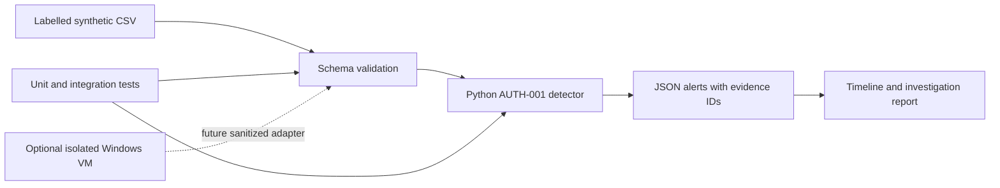

# windows-soc-investigation-lab

An offline Windows authentication analysis project with Python detection logic, reproducible test cases, and evidence-based investigation reports.

AUTH-001 correlates repeated failed network logons with a subsequent successful logon and produces JSON alerts with supporting evidence IDs. The repository includes 32 explicitly synthetic records, 21 automated tests, and an investigation report.

[CI results](https://github.com/husseinabdulkader/windows-soc-investigation-lab/actions/workflows/ci.yml) · [Detection specification](docs/detection.md) · [Investigation report](reports/authentication-investigation.md)

## Problem and architecture

Repeated failures followed by a successful logon may represent guessing, a user correcting mistakes, or repaired stored credentials. A detector flags the sequence; an analyst must establish context before recommending disruption.



The dashed path is planned. The current utility deliberately accepts only synthetic records; do not relabel collected events as synthetic to bypass validation.

## Prerequisites and quick start

Python 3.11+ is the intended minimum (3.14.2 locally verified, Python 3.14 tested in GitHub CI), no third-party dependencies. Git is optional for running the files. A Windows licence, VM, administrator account, network connection, and cloud account are not required for this offline workflow. Windows execution is verified locally and Linux execution through the linked Ubuntu CI run.

Open a terminal **in this repository folder** and run each command separately:

```text
python --version
python analyze.py data/authentication.csv --validate-only
python analyze.py data/authentication.csv
python -m unittest discover -s tests -v
```

The first command checks your interpreter. The second checks the data contract. The third prints evidence-linked JSON alerts. The fourth checks behaviour using deliberate edge cases. On Linux, use `python3` if that is your interpreter name. None of these commands changes Windows settings or contacts a cloud service.

Expected: **32 records** and **3 alerts**, for success IDs `P06`, `A06`, and `E06`. One alert is an intentionally authorized troubleshooting case, not proof of an attack. Compare the output with [expected-alerts.json](reports/expected-alerts.json).

## Documentation

1. [Schema and scenario manifest](docs/schema.md): what the fields mean.
2. [Detection specification](docs/detection.md): exact rule, limits and tuning.
3. [Authentication investigation](reports/authentication-investigation.md): evidence versus assumptions.
4. [Setup, troubleshooting and cleanup](docs/setup.md): execution, troubleshooting and optional event collection.
5. [Platform boundaries](docs/platforms.md): KQL, Sentinel and Defender prerequisites.
6. [Security objectives mapping](docs/objectives-mapping.md).

## Technical coverage

Input validation, timestamp handling, account/host/source correlation, sliding time windows, false-positive analysis, evidence references, investigation writing and automated regression tests.

## Limitations

Small in-memory batch analysis, not a streaming SIEM. Only logon type 3 with a known IP is detected. There is no EVTX parser, domain-controller authentication protocol analysis, password-spray rule, automatic response, or telemetry completeness guarantee. A successful logon does not prove what the account did afterward. Fixed thresholds and synthetic examples cannot establish production detection accuracy. IP matching can miss distributed attacks and conflate users behind shared infrastructure. KQL examples are illustrative and have not been executed in a live platform. Windows event collection and Sentinel/Defender integrations are documented extensions, not deployed components. See [verification](reports/verification.md) for tested environments and outstanding validation.

## Roadmap

1. **Implemented:** authentication detection, schema validation, regression tests and investigation report.
2. **Planned:** [unexpected privileged group membership changes](docs/next-investigation.md), including authorization context and a separate detection schema.
3. Add suspicious PowerShell activity with logging prerequisites, benign administration examples, and no automatic conclusion that PowerShell use is malicious.
4. Optionally collect sanitized VM evidence, then consider cloud integration only if explicitly authorized and funded/licensed.

## Data handling

The committed dataset is entirely synthetic. Raw captures, credentials, personal information and organization-specific data are excluded. Local evidence and modified test copies belong in ignored directories; `.gitignore` does not sanitize file contents.
