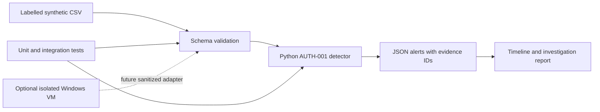

# windows-soc-investigation-lab

A small, offline SOC portfolio lab: turn synthetic Windows authentication records into an explainable alert and an evidence-based investigation. Intended for junior SOC analyst and security-focused IT support applications.

## Status and honesty

Milestone 1 implements AUTH-001, repeated network logon failures followed by success. Data is **entirely synthetic**, not exported from Windows or an employer. Python output is reproducible; see [verification](reports/verification.md) for actual checks and limits. Built with AI assistance and guided learning: the learner reported reproducing the alerts, testing a one-second boundary change and passing all 21 tests. These exercises do not claim independent authorship or production experience.

| Component | Status |
| --- | --- |
| CSV validation, Python detector, tests, authentication report | Implemented; local verification recorded separately |
| KQL learning example | Illustrative; no Kusto/Sentinel/Defender execution |
| GitHub Actions configuration | Written; not run on GitHub |
| Windows VM collection | Documented next exercise; not performed |
| Privileged group changes, suspicious PowerShell | Planned, not implemented |
| Sentinel / Defender XDR integration | Optional, not deployed |

No certifications, enterprise incident handling, or live SIEM experience are claimed. Security+ and SC-200 are study plans, not earned credentials. No Azure or other paid cloud resources have been provisioned.

## Problem and architecture

Repeated failures followed by a successful logon may represent guessing, a user correcting mistakes, or repaired stored credentials. A detector flags the sequence; an analyst must establish context before recommending disruption.



The dashed path is planned. The current utility deliberately accepts only synthetic records; do not relabel collected events as synthetic to bypass validation.

## Prerequisites and quick start

Python 3.11+ is the intended minimum (only 3.14.2 locally verified), no third-party dependencies. Git is optional for running the files. A Windows licence, VM, administrator account, network connection, and cloud account are not required for this offline exercise. Windows and Linux are intended targets; Windows execution is verified locally.

Open a terminal **in this repository folder** and run each command separately:

```text
python --version
python analyze.py data/authentication.csv --validate-only
python analyze.py data/authentication.csv
python -m unittest discover -s tests -v
```

The first command checks your interpreter. The second checks the data contract. The third prints evidence-linked JSON alerts. The fourth checks behaviour using deliberate edge cases. On Linux, use `python3` if that is your interpreter name. None of these commands changes Windows settings or contacts a cloud service.

Expected: **32 records** and **3 alerts**, for success IDs `P06`, `A06`, and `E06`. One alert is an intentionally authorized troubleshooting case, not proof of an attack. Compare the output with [expected-alerts.json](reports/expected-alerts.json).

## Read in this order

1. [Schema and scenario manifest](docs/schema.md): what the fields mean.
2. [Detection specification](docs/detection.md): exact rule, limits and tuning.
3. [Authentication investigation](reports/authentication-investigation.md): evidence versus assumptions.
4. [Setup, troubleshooting and cleanup](docs/setup.md): personal exercises and optional VM observation.
5. [Platform boundaries](docs/platforms.md): KQL, Sentinel and Defender prerequisites.
6. [Skills and interview preparation](docs/skills-and-interview.md).

## Demonstrated skills

Input validation, timestamp handling, account/host/source correlation, sliding time windows, false-positive analysis, evidence references, investigation writing and automated regression tests. These build on account administration and IT troubleshooting; they do not demonstrate operational Sentinel or Defender proficiency.

## Limitations

Small in-memory batch analysis, not a streaming SIEM. Only logon type 3 with a known IP is detected. There is no EVTX parser, domain-controller authentication protocol analysis, password-spray rule, automatic response, or telemetry completeness guarantee. A successful logon does not prove what the account did afterward. Fixed thresholds and synthetic examples cannot establish production detection accuracy. IP matching can miss distributed attacks and conflate users behind shared infrastructure.

## Milestones

1. Authentication: complete the offline implementation, tests and report; learner reproduces and explains the result.
2. [Unexpected privileged group membership changes](docs/next-investigation.md): next guided investigation, starting with the actor/member/group distinction. Detection implementation is planned.
3. Add suspicious PowerShell activity with logging prerequisites, benign administration examples, and no automatic conclusion that PowerShell use is malicious.
4. Optionally collect sanitized VM evidence, then consider cloud integration only if explicitly authorized and funded/licensed.

## Privacy and publication

Only synthetic data belongs in the current tracked dataset. Keep personal CVs, contact details, employer identifiers, credentials and raw captures out of the repository. `.gitignore` helps prevent accidents but does not sanitize data or remove files already tracked. Review `git status` and every staged diff before publication. Practice copies are excluded from version control.
